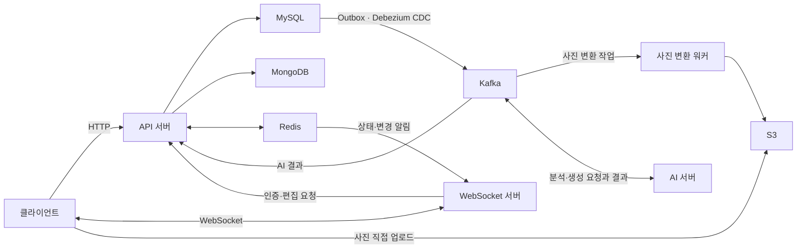

# 여담(旅談) Backend

여담은 여행 사진을 촬영 시각·위치·이미지 유사도에 따라 정리하고, 사진에 어울리는 글을 AI로 생성하는 서비스입니다.

- **여행(앨범)**: 이름과 기간을 가진 사진 묶음입니다. 예를 들어 '제주도 2박 3일' 앨범에 사진을 모아 지도와 목록으로 확인하고, 동행자와 함께 편집합니다.
- **여행 기록(스토리)**: 앨범의 사진과 AI가 생성한 글을 함께 배치한 콘텐츠입니다. 사용자가 글과 사진 구성을 수정할 수 있습니다.

## 백엔드 구조

API 서버는 인증·권한 검증과 데이터 처리를, 별도 WebSocket 서버는 편집 요청 전달과 상태·변경 알림을 담당합니다. 사진 변환은 백엔드 워커가, 사진 분석과 글 생성은 AI 서버가 수행합니다. 주요 비동기 처리 흐름은 다음과 같습니다.



| 기술 | 사용 목적 |
| --- | --- |
| Java 25 · Spring Boot 4.1.1 · Spring Security | API 구현과 인증·권한 검증 |
| MySQL · JPA · Flyway | 회원·앨범·사진 메타데이터 저장과 스키마 관리 |
| MongoDB | 글·사진 블록으로 구성된 스토리 본문 저장 |
| Redis · Redisson | 인증 상태·캐시·분산 락과 서버 간 알림 전달 |
| Kafka · DB Outbox · Debezium CDC | 사진 변환·AI 작업의 비동기 전달 |
| S3 · libvips · libheif · ExifTool | 사진 저장·변환과 촬영 정보 추출 |

## 디렉터리 구조

주요 경로를 발췌했습니다. 도메인별로 요청 처리·업무 로직·데이터 접근을 나눕니다. `event`는 작업 요청·결과와 상태 변경을 정의하고, `event/handler`는 후속 처리를 담당합니다.

```text
yeodam-be/
├── src/main/java/com/yeodam/yeodambe/
│   ├── user/          # 회원·인증
│   ├── trip/          # 앨범·사진·공유·편집
│   │   ├── controller/
│   │   ├── service/   # 업무 로직과 request/response DTO
│   │   ├── entity/
│   │   ├── repository/
│   │   ├── client/    # 외부 시스템 연동
│   │   ├── event/     # 이벤트 정의와 handler/의 후속 처리
│   │   └── exception/
│   ├── story/         # 스토리 생성·조회·편집
│   ├── search/        # 검색
│   ├── file/          # 파일 관련 데이터
│   ├── integration/   # 공용 AI 연동·메시지 수신
│   └── common/        # 공통 설정·응답·예외·이벤트·WebSocket 연동
└── websocket-server/  # 별도 실행하는 WebSocket 서버
```

## 주요 기술 과제

| 과제 | 적용한 방법 |
| --- | --- |
| 사진 처리·AI 연동의 비동기화 | 사진 변환·AI 분석 요청을 Outbox와 Kafka로 전달하고, 접수와 완료 상태를 구분합니다. [코드](./src/main/java/com/yeodam/yeodambe/trip/service/AttachmentConversionEnqueueService.java) |
| 사진 목록 조회·캐시 | Redis에 조회 응답을 캐시하고, 동일 요청 병합과 분산 락으로 캐시 재생성 시 요청 집중을 제어합니다. [코드](./src/main/java/com/yeodam/yeodambe/trip/service/TripAttachmentResponseCacheService.java) |
| 공유 앨범의 동시 편집 | 앨범 단위 분산 락과 요청 식별자를 사용해 동시 수정과 중복 요청을 제어합니다. [코드](./src/main/java/com/yeodam/yeodambe/trip/service/TripEditCommandService.java) |
| 스토리 본문 저장 | 글·사진 블록은 MongoDB에, 소유권과 생성 상태 등 메타데이터는 MySQL에 저장합니다. [코드](./src/main/java/com/yeodam/yeodambe/story/service/StoryContentStorageService.java) |

## 실행·테스트

Java 25와 기능별 외부 서비스·사진 처리 도구가 필요합니다. 테스트는 JUnit 5·H2·Testcontainers를 사용하며, 통합 테스트에는 Docker가 필요합니다.

```sh
./gradlew bootRun --args='--spring.profiles.active=local'
./gradlew test
./gradlew bootJar
```
